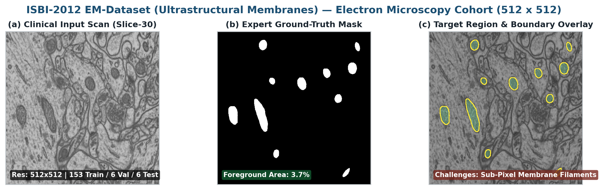
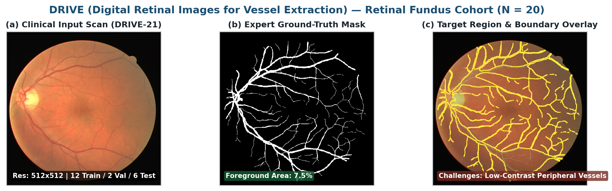
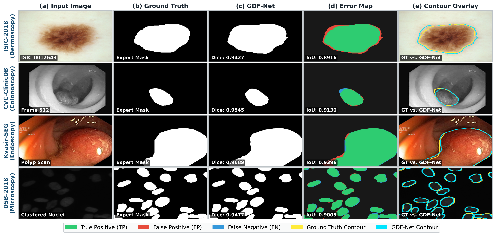
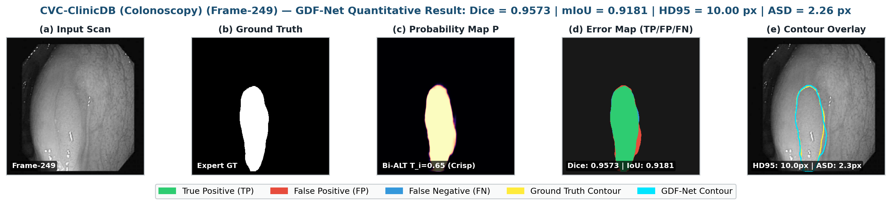
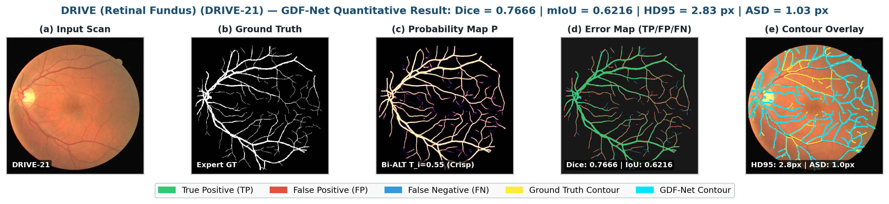

# GDF-Net: Gated Residual Decoupling and Mask-Guided Feedback for Medical Image Segmentation

[](https://pytorch.org/)
[](https://www.python.org/)
[](LICENSE)
[](#citation)

Official PyTorch implementation of **"GDF-Net: Gated Residual Decoupling and Mask-Guided Feedback for Medical Image Segmentation"**.


## 1. Datasets: Descriptions, Download Guide & Samples

### 1.1 Overview of Evaluated Datasets

| Dataset | Clinical Modality | Target | Total Scans | Train / Val / Test Split | Resolution | Key Characteristics |
| :--- | :--- | :--- | :---: | :---: | :---: | :--- |
| **ISIC-2018 (Task 1)** | Dermoscopy (RGB) | Skin Lesions | `3,694` | `2,594` / `100` / `1,000` (Official) | $384 \times 384$ | Hair occlusion, optical vignetting, diffuse borders |
| **CVC-ClinicDB** | Colonoscopy (RGB) | Colorectal Polyps | `612` | `490` / `61` / `61` (`80/10/10`) | $384 \times 384$ | Specular mucosal glare, flat sessile margins (29 sequences) |
| **Kvasir-SEG** | GI Endoscopy (RGB) | GI Polyps | `1,000` | `800` / `100` / `100` (`80/10/10`) | $384 \times 384$ | Pedunculated polyp stalks, complex mucosal folds |
| **DSB-2018** | Cellular Microscopy | Cell Nuclei ($\mathbf{Y} = \bigcup_k \mathbf{I}_k$) | `670` | `536` / `67` / `67` (`80/10/10`) | $256 \times 256$ | Clustered nuclei across brightfield & fluorescence |
| **ISBI-2012 EM** | Electron Microscopy | Neuronal Membranes | `165` slices | `153` / `6` / `6` | $512 \times 512$ | Dense sub-pixel membrane filaments |
| **CHASE-DB1** | Retinal Fundus | Retinal Vessels | `28` | `20` / `4` / `4` | $768 \times 768$ | Thin 1–2 px capillary bifurcations |
| **DRIVE** | Retinal Fundus | Retinal Vessels | `20` | `12` / `2` / `6` | $576 \times 576$ | Low-contrast peripheral vessel branches |

---

### 1.2 How to Download All Datasets

#### Option A: Automated CLI Script (Recommended)

Configure your Kaggle API credentials (`~/.kaggle/kaggle.json`) and run [`scripts/download_datasets.py`](scripts/download_datasets.py):

```bash
# Download and prepare all datasets automatically
python scripts/download_datasets.py --data-root ./data --dataset all

# Or download a specific dataset:
python scripts/download_datasets.py --data-root ./data --dataset isic2018
python scripts/download_datasets.py --data-root ./data --dataset cvc_clinicdb
python scripts/download_datasets.py --data-root ./data --dataset kvasir_seg
python scripts/download_datasets.py --data-root ./data --dataset dsb2018
```

#### Option B: Direct Kaggle CLI / Official Archive Commands

```bash
# 1. ISIC-2018 Task 1 (Official Train/Test via Kaggle + Official 100-Image Validation via ISIC S3)
kaggle datasets download -d tschandl/isic2018-challenge-task1-data-segmentation -p ./data/ISIC-2018 --unzip
kaggle datasets download -d mfahimhossen/isic2018-test-groundtruth -p ./data/ISIC-2018 --unzip
wget https://isic-archive.s3.amazonaws.com/challenges/2018/ISIC2018_Task1-2_Validation_Input.zip -P ./data/ISIC-2018
wget https://isic-archive.s3.amazonaws.com/challenges/2018/ISIC2018_Task1_Validation_GroundTruth.zip -P ./data/ISIC-2018

# 2. CVC-ClinicDB
kaggle datasets download -d balraj98/cvcclinicdb -p ./data/CVC-ClinicDB --unzip

# 3. Kvasir-SEG
kaggle datasets download -d debeshjha1/kvasirseg -p ./data/Kvasir-SEG --unzip

# 4. DSB-2018
kaggle competitions download -c data-science-bowl-2018 -f stage1_train.zip -p ./data/DSB-2018

# 5. Extended Datasets (EM-Dataset, CHASE-DB1, DRIVE)
kaggle datasets download -d namnguynnnn/isbi2012-em-dataset -p ./data/EM-Dataset --unzip
kaggle datasets download -d khoongweihao/chasedb1 -p ./data/CHASE_DB1 --unzip
kaggle datasets download -d andrewmvd/drive-digital-retinal-images-for-vessel-extraction -p ./data/DRIVE --unzip
```

---

### 1.3 Dataset Descriptions & Representative Samples (1 Sample per Dataset)

#### 1. ISIC-2018 (Dermoscopy Skin Lesion Segmentation)
- **Description:** `3,694` dermoscopy scans across official splits of `2,594` train, `100` validation, and `1,000` test images ($384 \times 384$), featuring fuzzy borders, hair artifacts, and wide lesion scale variation.


#### 2. CVC-ClinicDB (Colonoscopy Polyp Segmentation)
- **Description:** `612` colonoscopy frames from `29` sequences ($384 \times 384$, `490` train / `61` val / `61` test) with mucosal folds and specular glare.


#### 3. Kvasir-SEG (Gastrointestinal Endoscopy Polyp Segmentation)
- **Description:** `1,000` gastrointestinal polyp scans ($384 \times 384$, `800` train / `100` val / `100` test) spanning variable polyp morphology and illumination conditions.


#### 4. DSB-2018 (Cellular Microscopy Nuclei Segmentation)
- **Description:** `670` microscopy images ($256 \times 256$, `536` train / `67` val / `67` test) across brightfield, histopathology, and fluorescence modalities; per-nucleus instance masks $\{\mathbf{I}_k\}$ are merged via logical union ($\mathbf{Y} = \bigcup_k \mathbf{I}_k$).


#### 5. Extended Cohorts: ISBI-2012 EM-Dataset, CHASE-DB1 & DRIVE
- **Description:** High-resolution neuronal membrane segmentation (`ISBI-2012 EM-Dataset`, $512 \times 512$) and retinal blood vessel segmentation (`CHASE-DB1`, $768 \times 768$; `DRIVE`, $576 \times 576$).





---

## 2. Results: Quantitative Benchmarks & Qualitative Samples

### 2.1 ISIC-2018 Official 1,000-Image Test Benchmark

| Model / Variant | FPS | Macro Dice | mIoU | Median Dice | HD95 (px) | ASD (px) | Low-IoU ($J<0.65$) |
| :--- | :---: | :---: | :---: | :---: | :---: | :---: | :---: |
| *U-Net (Ronneberger et al., 2015)* | 62.0$^\dagger$ | 0.8840 | 0.8012 | --- | --- | --- | --- |
| *TransUNet (Chen et al., 2021)* | 18.2$^\dagger$ | 0.8840 | 0.8130 | --- | --- | --- | --- |
| *Swin-Unet (Cao et al., 2022)* | 38.5$^\dagger$ | 0.8920 | 0.8250 | --- | --- | --- | --- |
| *FAT-Net (Wu et al., 2022)* | 34.0$^\dagger$ | 0.8985 | 0.8310 | --- | --- | --- | --- |
| *PVTv2-B2 (Wang et al., 2022)* | 41.2$^\dagger$ | 0.9020 | 0.8350 | --- | --- | --- | --- |
| *EMCAD (Rahman et al., CVPR 2024)* | 31.4$^\dagger$ | 0.9020 | 0.8350 | --- | --- | --- | --- |
| *MedNeXt-B (Roy et al., MICCAI 2023)* | 22.8$^\dagger$ | 0.9061 | 0.8385 | --- | --- | --- | --- |
| **GDF-Net (Base, $\tau=0.50$)** | **31.3** | 0.9017 | 0.8332 | 0.9316 | 22.51 | 8.84 | 83 |
| **GDF-Net (+Bi-ALT)** | **31.3** | 0.9105 | 0.8491 | 0.9446 | 21.84 | 8.25 | 88 |
| **GDF-Net (Soup, SV)** | **31.3** | 0.9126 | <u>0.8519</u> | <u>0.9461</u> | <u>21.45</u> | 8.10 | 81 |
| **GDF-Net (Real-Time) `[Ref.]`** | **31.3** | <u>0.9127</u> | 0.8516 | 0.9448 | 21.58 | <u>8.02</u> | **74** |
| **GDF-Net (Ensemble, 8V)** | 3.8 | **0.9146** | **0.8554** | **0.9490** | **21.23** | **8.00** | <u>77</u> |

---

### 2.2 Multi-Dataset & Cross-Dataset Generalization

| Cohort / Transfer | Model / Variant | FPS | Macro Dice | mIoU | BF2 (2-px) | HD95 (px) | ASD (px) |
| :--- | :--- | :---: | :---: | :---: | :---: | :---: | :---: |
| **CVC-ClinicDB** ($384^2, N=61$) | PVTv2-B2 (Same-Split Baseline) | 28.4 | 0.9426 | 0.8951 | 0.6955 | 11.27 | 2.94 |
| | GDF-Net (Base, $\tau=0.50$) | **31.3** | 0.9249 | 0.8757 | 0.6802 | 19.22 | 7.19 |
| | GDF-Net (Soup, SV) | **31.3** | 0.9395 | 0.8899 | <u>0.6969</u> | <u>10.53</u> | <u>2.86</u> |
| | **GDF-Net (Real-Time) `[Ref.]`** | **31.3** | <u>0.9397</u> | <u>0.8910</u> | 0.6957 | 15.74 | 3.74 |
| | **GDF-Net (Ensemble, 8V)** | 3.8 | **0.9492** | **0.9056** | **0.7188** | **8.11** | **2.35** |
| **Kvasir-SEG** ($384^2, N=100$) | PVTv2-B2 (Same-Split Baseline) | 28.4 | <u>0.9343</u> | <u>0.8889</u> | 0.6629 | 20.71 | 4.65 |
| | GDF-Net (Base, $\tau=0.50$) | **31.3** | 0.9291 | 0.8824 | 0.6694 | 20.61 | 4.96 |
| | GDF-Net (Soup, SV) | **31.3** | 0.9308 | 0.8859 | <u>0.6748</u> | 20.08 | 4.95 |
| | **GDF-Net (Real-Time) `[Ref.]`** | **31.3** | **0.9409** | **0.8979** | **0.6802** | <u>19.63</u> | **4.48** |
| | **GDF-Net (Ensemble, 8V)** | 3.8 | 0.9335 | 0.8896 | 0.6735 | **18.91** | <u>4.57</u> |
| **DSB-2018** ($256^2, N=67$) | PVTv2-B2 (Same-Split Baseline) | 27.5 | 0.8919 | 0.8157 | 0.9152 | 9.36 | 2.85 |
| | GDF-Net (Base, $\tau=0.50$) | **30.0** | 0.8955 | 0.8213 | 0.9198 | <u>9.32</u> | 2.69 |
| | GDF-Net (Soup, SV) | **30.0** | 0.8941 | 0.8194 | 0.9161 | 9.34 | 2.72 |
| | **GDF-Net (Real-Time) `[Ref.]`** | **30.0** | **0.8992** | **0.8265** | <u>0.9250</u> | 9.89 | <u>2.63</u> |
| | **GDF-Net (Ensemble, 8V)** | 3.7 | <u>0.8974</u> | <u>0.8233</u> | **0.9260** | **9.18** | **2.61** |
| **Zero-Shot: CVC $\to$ Kvasir** | GDF-Net (Base, $\tau=0.50$) | **31.3** | <u>0.8783</u> | **0.8146** | **0.5797** | <u>33.48</u> | **9.13** |
| | **GDF-Net (Ensemble, 8V)** | 3.8 | **0.8789** | <u>0.8129</u> | <u>0.5415</u> | **31.75** | <u>9.17</u> |
| **Zero-Shot: Kvasir $\to$ CVC** | GDF-Net (Base, $\tau=0.50$) | **31.3** | 0.7872 | 0.7279 | <u>0.5021</u> | 84.66 | <u>34.82</u> |
| | GDF-Net (+Bi-ALT, SV) | **31.3** | <u>0.7884</u> | <u>0.7289</u> | 0.4955 | <u>84.64</u> | 34.87 |
| | **GDF-Net (Ensemble, 8V)** | 3.8 | **0.8071** | **0.7497** | **0.5410** | **57.35** | **21.62** |

---

### 2.3 Qualitative Segmentation Results (1 Sample Result per Dataset)

#### Consolidated 4-Dataset Qualitative Comparison


#### 1. ISIC-2018 (Dermoscopy)


#### 2. CVC-ClinicDB (Colonoscopy)


#### 3. Kvasir-SEG (Gastrointestinal Endoscopy)


#### 4. DSB-2018 (Cellular Microscopy Nuclei)


#### 5. Extended Cohorts: ISBI-2012 EM-Dataset (`0.9525` Dice), CHASE-DB1 (`0.8238` Dice) & DRIVE (`0.7982` Dice)


