# GDF-Net: Gated Residual Decoupling and Mask-Guided Feedback for Medical Image Segmentation

[](https://pytorch.org/)
[](https://www.python.org/)
[](LICENSE)
[](#6-citation)

Official PyTorch implementation of **"GDF-Net: Gated Residual Decoupling and Mask-Guided Feedback for Medical Image Segmentation"**.

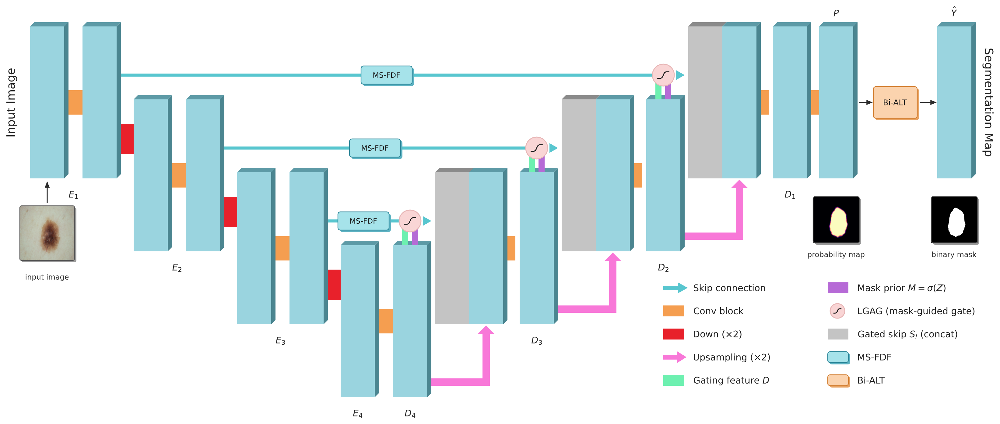

---

## Table of Contents

1. [Pretrained Weights](#1-pretrained-weights)
2. [Repository Structure](#2-repository-structure)
3. [Datasets: Descriptions, Deterministic Splits & Download Guide](#3-datasets-descriptions-deterministic-splits--download-guide)
4. [Results: Visualizations & Qualitative Samples](#4-results-visualizations--qualitative-samples)
5. [Quick Start: Installation, Training, Ablation & Statistical Testing](#5-quick-start-installation-training-ablation--statistical-testing)
6. [Citation](#6-citation)

---

## 1. Pretrained Weights

All released checkpoints are standard PyTorch `.pth` state dicts (`29,503,181` parameters, `534` keys). Download them via the Kaggle CLI and verify that each one loads into `GDFNet` with `strict=True`:

```bash
python scripts/download_weights.py --out-dir ./checkpoints --download-kaggle --verify
```

| Checkpoint | Dataset | Variant |
| :--- | :--- | :--- |
| `GDFNet_ISIC2018_Base_M1_ConvFormerS18_300ep_best.pth` | ISIC-2018 | Base ($M_1$ teacher) |
| `GDFNet_ISIC2018_Teacher_M2_LLRD_MultiScale_best.pth` | ISIC-2018 | $M_2$ multi-scale LLRD teacher |
| `GDFNet_ISIC2018_Soup_M1_M4_WiSE_best.pth` | ISIC-2018 | Weight soup ($0.70 M_1 + 0.30 M_4$) |
| `GDFNet_ISIC2018_RealTime_Distilled_Student_best.pth` | ISIC-2018 | Real-time distilled student |
| `GDFNet_CVC_ClinicDB_ConvFormerS18_best.pth` | CVC-ClinicDB | Base |
| `GDFNet_Kvasir_SEG_ConvFormerS18_best.pth` | Kvasir-SEG | Base |
| `GDFNet_DSB2018_ConvFormerS18_best.pth` | DSB-2018 | Base |

See [`MIDL_REPRODUCIBILITY_CHECKLIST.md`](MIDL_REPRODUCIBILITY_CHECKLIST.md) for the MIDL reproducibility checklist.

---

## 2. Repository Structure

```text
GDF-Net_GitHub_Release/
├── gdfnet/      # Core package: models, losses, inference (Bi-ALT, TTA, weight soup), data, metrics
├── scripts/     # Dataset/weight download, training, evaluation, ablation & profiling
├── configs/     # YAML hyperparameters for main runs and ablations
├── splits/      # Deterministic train/val/test split manifest
├── tests/       # Unit tests for the model equations & ablation variants
├── notebooks/   # Training & evaluation notebooks
├── results/     # Benchmark CSV summaries
└── assets/      # Figures used in this README
```

---

## 3. Datasets: Descriptions, Deterministic Splits & Download Guide

### 3.1 Overview of Evaluated Datasets

| Dataset | Clinical Modality | Target | Total Scans | Train / Val / Test Split | Resolution | Key Clinical Challenges |
| :--- | :--- | :--- | :---: | :---: | :---: | :--- |
| **ISIC-2018 (Task 1)** | Dermoscopy (RGB) | Skin Lesions | `3,694` | `2,594` / `100` / `1,000` (Official) | $384 \times 384$ | Hair occlusion, low contrast, optical vignetting, diffuse borders |
| **CVC-ClinicDB** | Colonoscopy (RGB) | Colorectal Polyps | `612` | `490` / `61` / `61` (`80/10/10`) | $384 \times 384$ | Specular mucosal glare, flat sessile margins (29 sequences) |
| **Kvasir-SEG** | GI Endoscopy (RGB) | GI Polyps | `1,000` | `800` / `100` / `100` (`80/10/10`) | $384 \times 384$ | Pedunculated polyp stalks, complex mucosal folds, variable scale |
| **DSB-2018** | Cellular Microscopy | Cell Nuclei ($\mathbf{Y} = \bigcup_k \mathbf{I}_k$) | `670` | `536` / `67` / `67` (`80/10/10`) | $256 \times 256$ | Clustered nuclei across brightfield, histopathology & fluorescence |
| **ISBI-2012 EM** | Electron Microscopy | Neuronal Membranes | `165` slices | `153` / `6` / `6` | $512 \times 512$ | Dense sub-pixel membrane filaments |
| **CHASE-DB1** | Retinal Fundus | Retinal Vessels | `28` | `20` / `4` / `4` | $768 \times 768$ | Thin 1–2 px capillary bifurcations |
| **DRIVE** | Retinal Fundus | Retinal Vessels | `20` | `12` / `2` / `6` | $576 \times 576$ | Low-contrast peripheral vessel branches |

### 3.2 How to Download All Datasets

#### Option A: Automated CLI Script (Recommended)

Configure your Kaggle API credentials (`~/.kaggle/kaggle.json`, or the `KAGGLE_USERNAME` / `KAGGLE_KEY` environment variables used by the notebooks; never commit keys) and run [`scripts/download_datasets.py`](scripts/download_datasets.py):

```bash
# Download and prepare all datasets automatically
python scripts/download_datasets.py --data-root ./data --dataset all

# Or download a specific dataset:
python scripts/download_datasets.py --data-root ./data --dataset isic2018
python scripts/download_datasets.py --data-root ./data --dataset cvc_clinicdb
python scripts/download_datasets.py --data-root ./data --dataset kvasir_seg
python scripts/download_datasets.py --data-root ./data --dataset dsb2018
```

#### Option B: Direct Kaggle CLI / Official Archive Commands

```bash
# 1. ISIC-2018 Task 1 (Official Train/Test via Kaggle + Official 100-Image Validation via ISIC S3)
kaggle datasets download -d tschandl/isic2018-challenge-task1-data-segmentation -p ./data/ISIC-2018 --unzip
kaggle datasets download -d mfahimhossen/isic2018-test-groundtruth -p ./data/ISIC-2018 --unzip
wget https://isic-archive.s3.amazonaws.com/challenges/2018/ISIC2018_Task1-2_Validation_Input.zip -P ./data/ISIC-2018
wget https://isic-archive.s3.amazonaws.com/challenges/2018/ISIC2018_Task1_Validation_GroundTruth.zip -P ./data/ISIC-2018

# 2. CVC-ClinicDB
kaggle datasets download -d balraj98/cvcclinicdb -p ./data/CVC-ClinicDB --unzip

# 3. Kvasir-SEG
kaggle datasets download -d debeshjha1/kvasirseg -p ./data/Kvasir-SEG --unzip

# 4. DSB-2018
kaggle competitions download -c data-science-bowl-2018 -f stage1_train.zip -p ./data/DSB-2018

# 5. Extended Datasets (EM-Dataset, CHASE-DB1, DRIVE)
kaggle datasets download -d namnguynnnn/isbi2012-em-dataset -p ./data/EM-Dataset --unzip
kaggle datasets download -d khoongweihao/chasedb1 -p ./data/CHASE_DB1 --unzip
kaggle datasets download -d andrewmvd/drive-digital-retinal-images-for-vessel-extraction -p ./data/DRIVE --unzip
```

### 3.3 Dataset Descriptions & Representative Samples (1 Sample per Dataset)

#### 1. ISIC-2018 (Dermoscopy Skin Lesion Segmentation)
- **Description:** `3,694` dermoscopy scans across official splits of `2,594` train, `100` validation, and `1,000` test images ($384 \times 384$), featuring fuzzy borders, hair artifacts, and wide lesion scale variation.

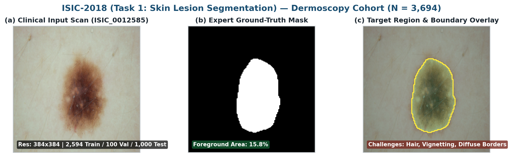

#### 2. CVC-ClinicDB (Colonoscopy Polyp Segmentation)
- **Description:** `612` colonoscopy frames from `29` sequences ($384 \times 384$, `490` train / `61` val / `61` test) with mucosal folds and specular glare.

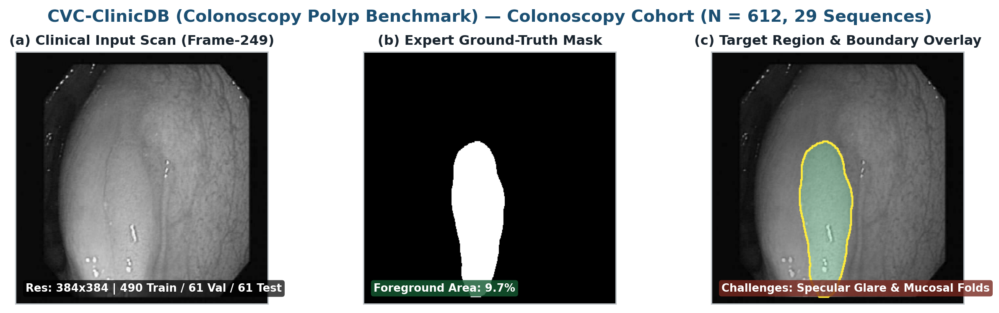

#### 3. Kvasir-SEG (Gastrointestinal Endoscopy Polyp Segmentation)
- **Description:** `1,000` gastrointestinal polyp scans ($384 \times 384$, `800` train / `100` val / `100` test) spanning variable polyp morphology and illumination conditions.

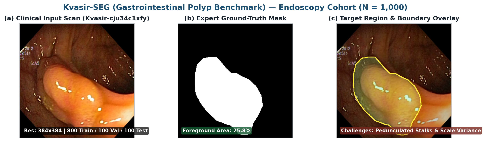

#### 4. DSB-2018 (Cellular Microscopy Nuclei Segmentation)
- **Description:** `670` microscopy images ($256 \times 256$, `536` train / `67` val / `67` test) across brightfield, histopathology, and fluorescence modalities; per-nucleus instance masks $\{\mathbf{I}_k\}$ are merged via logical union ($\mathbf{Y} = \bigcup_k \mathbf{I}_k$).

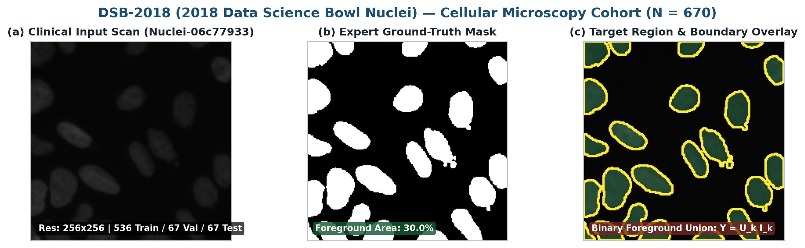

#### 5. Extended Cohorts: ISBI-2012 EM-Dataset, CHASE-DB1 & DRIVE
- **Description:** High-resolution neuronal membrane segmentation (`ISBI-2012 EM-Dataset`, $512 \times 512$) and retinal blood vessel segmentation (`CHASE-DB1`, $768 \times 768$; `DRIVE`, $576 \times 576$).


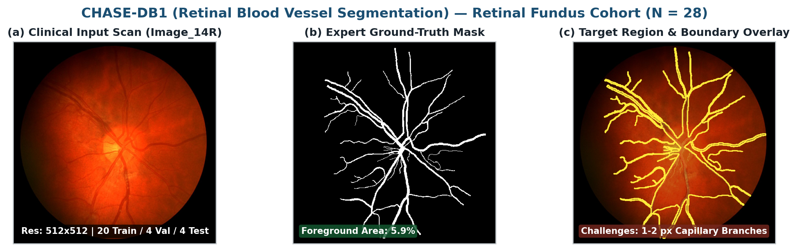


---

## 4. Results: Visualizations & Qualitative Samples

Full quantitative results (Dice, mIoU, HD95, ASD, BF2 and significance tests) are reported in the paper; the verified per-run summaries are provided as CSV files in [`results/`](results/) and can be regenerated with the commands in [Section 5](#5-quick-start-installation-training-ablation--statistical-testing).

### 4.1 Mechanistic Feature Visualization (MS-FDF & Mask-Guided LGAG)

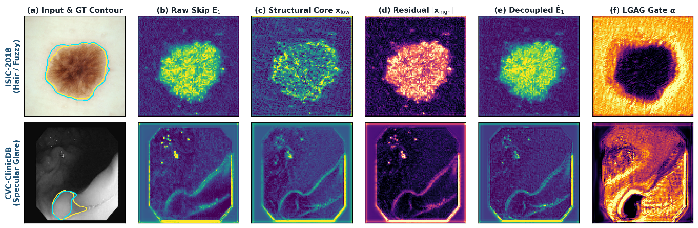

### 4.2 Consolidated Qualitative Segmentation Results


### 4.3 Qualitative Segmentation Results (1 Sample Result per Dataset)

#### 1. ISIC-2018 (Dermoscopy)
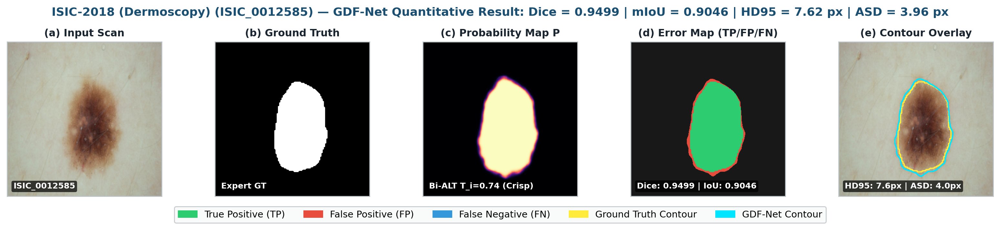

#### 2. CVC-ClinicDB (Colonoscopy)


#### 3. Kvasir-SEG (Gastrointestinal Endoscopy)
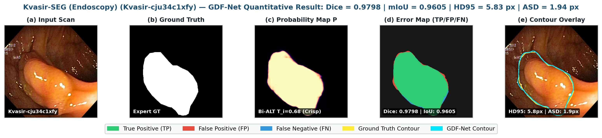

#### 4. DSB-2018 (Cellular Microscopy Nuclei)
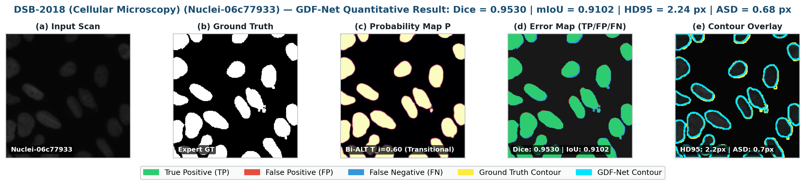

#### 5. Extended Cohorts: ISBI-2012 EM-Dataset, CHASE-DB1 & DRIVE
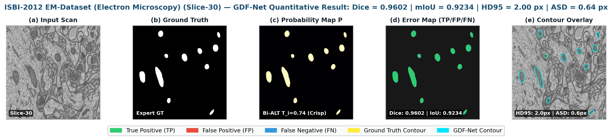
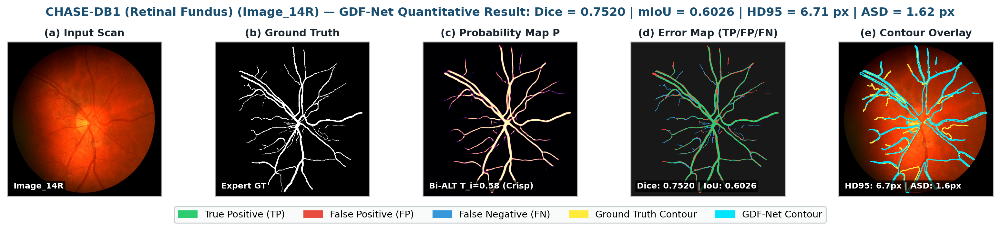


---

## 5. Quick Start: Installation, Training, Ablation & Statistical Testing

```bash
# 1. Install pinned dependencies (or create Conda env via environment.yml)
pip install -r requirements.txt

# 2. Run mathematical & architectural consistency unit tests (Eqs. 1-11 + 7 ablation configs)
pytest tests/test_mathematical_consistency.py -v

# 3. Download & verify pretrained checkpoints
python scripts/download_weights.py --out-dir ./checkpoints --download-kaggle --verify

# 4. Profile Fixed-Backbone (ConvFormer-S18) Leave-One-Out Ablation Complexity Matrix
python scripts/run_ablation_suite.py --mode profile

# 4b. Train GDF-Net (Base) on ISIC-2018 with the M1 protocol
#     (AdamW encoder 1e-4 / decoder 3e-4, wd 2e-4, warm restarts T_0=50, T_mult=2, DropPath 0.2, EMA 0.999, 300 epochs, B=16)
python scripts/train_base.py   --train-img ./data/ISIC-2018/ISIC2018_Task1-2_Training_Input --train-gt ./data/ISIC-2018/ISIC2018_Task1_Training_GroundTruth   --val-img ./data/ISIC-2018/ISIC2018_Task1-2_Validation_Input --val-gt ./data/ISIC-2018/ISIC2018_Task1_Validation_GroundTruth   --out-dir ./checkpoints/base

# 4c. Train one leave-one-out configuration (Table 3, Panel A) with the same protocol
python scripts/train_base.py <same data arguments> --ablation cfg1_baseline --out-dir ./checkpoints/cfg1

# 5. Run Statistical Significance Tests (Paired t-test, Wilcoxon, Holm-Bonferroni) & Benchmark Summaries
python scripts/run_statistical_tests.py
python scripts/evaluate_all_benchmarks.py

# 6. Profile Hardware Latency (ms), Throughput (FPS) & Peak VRAM
python scripts/profile_hardware.py --resolutions 256 384 512 768
```

---

## 6. Citation

```bibtex
@inproceedings{nguyen2027gdfnet,
  title     = {{GDF-Net}: Gated Residual Decoupling and Mask-Guided Feedback for Medical Image Segmentation},
  author    = {Nguyen, Ho-Nam},
  booktitle = {Medical Imaging with Deep Learning (MIDL)},
  year      = {2027}
}
```
